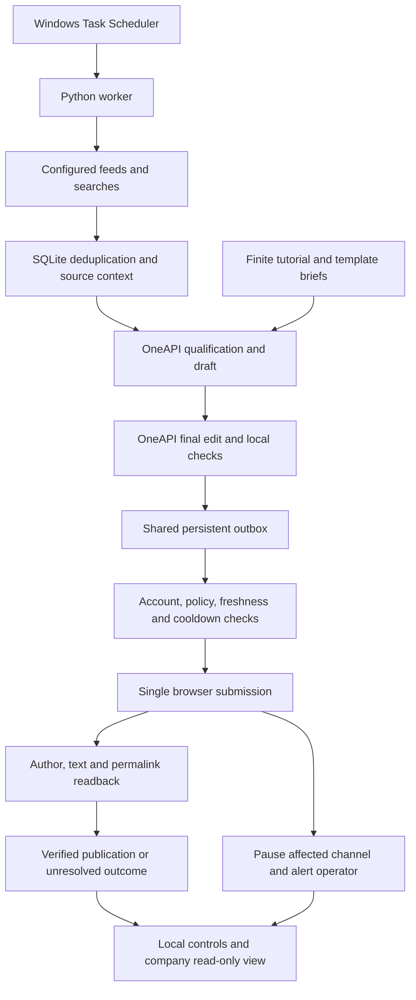

# Architecture and maintainer guide

The agent is a Python process on Windows. Task Scheduler starts `windows/runner.py`, which runs `pilot serve`. Comate OneAPI hosts the models; the Mac, Codex and this chat are not runtime dependencies. Local Playwright adapters execute browser actions. Ordinary DOM extraction avoids model calls; the bounded Reddit Browser Use fallback also uses OneAPI.



## Modules

| Module | Responsibility |
| --- | --- |
| `pilot/core.py` | Configuration/catalog loading, input validation, SQLite queue, model budget ledger |
| `pilot/service.py` | Worker loop, channel orchestration, loopback and private read-only HTTP listeners |
| `pilot/channels.py` | Platform scoping, account binding, per-channel controls and scheduling |
| `pilot/browser.py`, `dom.py`, `discovery.py` | Reddit browser extraction, feeds/searches and full source reading |
| `pilot/agent_browser.py` | Bounded read-only Browser Use fallback through OneAPI |
| `pilot/gateway.py`, `quality.py`, `context.py` | Model calls, grounded replies, evidence and text quality checks |
| `pilot/campaigns.py`, `automation.py` | Standalone content plans, automatic eligibility and final quality receipts |
| `pilot/workflow.py` | Durable outbox, shared pacing, source/draft binding and publication verification |
| `pilot/forum_browser.py` | DEV, Indie Hackers and Discourse browser adapters |
| `pilot/attention.py` | Persistent browser challenge and recovery state |
| `pilot/aliasmode.py`, `ixbrowser.py` | Optional existing managed Reddit profile connections |
| `pilot/dashboard.html` | Platform readiness, account/CAPTCHA controls and reply/post queues |
| `windows/` | Dependency setup, Task Scheduler registration and rotating logs |

## State and failure boundaries

All channels share one SQLite database and one model/publication budget. A `platform` value scopes queue claims; legacy `subreddit` fields represent the destination for non-Reddit items. A quality receipt binds the exact source, result and destination policy. A changed source, changed draft, stale receipt or changed policy cannot silently reuse authorization to publish.

Before clicking submit, the worker records a submitting marker. It clicks once and reads the resulting content back, including its author and permalink. A crash or ambiguous readback is an uncertain outcome, not an invitation to retry. The affected channel pauses; the global pause controls all channels. A per-channel failure does not authorize profile rotation.

Browser operations stay on the worker thread. HTTP control handlers enqueue commands instead of manipulating Playwright from arbitrary request threads. The company listener is read-only; localhost controls enforce origin and CSRF checks. A process lock prevents overlapping workers sharing one runtime.

## Extending the pilot

1. Choose a real destination and confirm the intended collection/publication rules.
2. Add or extend an adapter with explicit identity, source, composer and permalink checks. Keep URLs confined to the configured origin.
3. Add deterministic browser fixtures for successful submission, wrong account, CAPTCHA, changed source and uncertain readback. Fixtures must intercept social-site requests.
4. Validate the actual signed-in site UI with the intended account before unattended publication.
5. Record the destination policy and a small finite content plan; retain shared limits and evidence-backed claims.

Do not add accounts to work around rate limits or challenges. Do not describe an adapter scaffold as a verified integration. See [MULTIPLATFORM.md](MULTIPLATFORM.md) for current platform-specific limits.

## Development and checks

Portable tests can run without live credentials:

```sh
python -m unittest discover -s tests -v
python -m compileall -q pilot windows tools
```

Run the complete browser fixture suite with installed Chrome and dependencies:

```sh
PILOT_BROWSER_TESTS=1 .venv/bin/python -m unittest discover -s tests -v
```

On Windows, use `windows\setup.ps1 -InstallChrome -RunTests` as documented in [DEPLOYMENT.md](DEPLOYMENT.md). CI uses no platform login or OneAPI key. Browser fixtures establish implementation behavior, not website permission or live reliability.

The existing `.github/workflows/ci.yml` is a GitHub Actions workflow; iCode does not execute it automatically. An iCode/iPipe job requires an approved runner capable of the Python 3.14 and Chrome checks above. No new build capacity or automatic deployment pipeline is provisioned by importing this repository.
